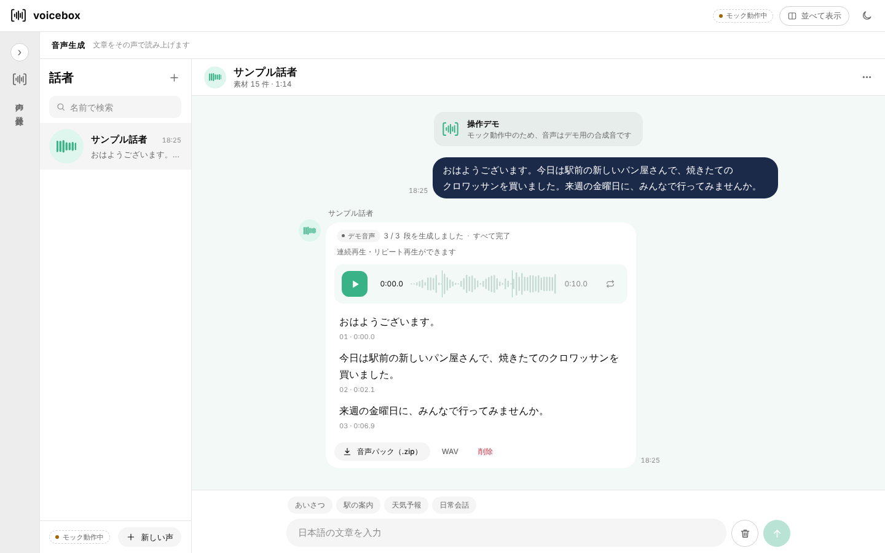

# voicebox — 音声クローンWebアプリのフロントエンド

> 授業「情報ネットワーク」のグループ課題で開発した、音声クローンWebアプリのフロントエンドです。
> **私はフロントエンド全体（UI設計・実装）を担当しました。** 音声学習・音声合成を行うバックエンドは、ほかのメンバーが担当しています。

🔗 **デモ**：https://mutant000.github.io/voicebox/
（公開版はモックモードで動作します。録音・学習・生成の流れは実際に操作できますが、再生される音声はデモ用のダミー音声で、実際の声のクローンは行いません。）



## 概要

自分の声を 30 秒〜5 分録音、または音声ファイルを追加して話者を登録すると、その声で日本語の文章を読み上げる Web アプリです。

- **声の登録**：マイク録音とファイル追加を切り替えて使える。合計時間（30 秒〜5 分）をチェックし、ファイルごとに成功・失敗とその理由を表示
- **学習の進捗表示**：学習状況をジョブ単位でポーリングし、進捗を表示。学習中の話者は生成に使えない
- **音声生成**：チャット形式で文章を送ると、音声で返ってくる。文ごとに分割してリクエストし、「2 / 3 段目を生成しています…」のように進捗を表示
- **生成の中断**：AbortController でリクエストを中断・破棄できる
- **プレイヤー**：波形のクリックでシーク、段落ごとの区切り表示、リピート再生
- **ダウンロード**：WAV のほか、全体・各段落の WAV とテキストをまとめた「音声パック（.zip）」を外部ライブラリなしで生成

## 技術スタック

- HTML / CSS / JavaScript（フレームワーク不使用）
- Web Audio API・MediaRecorder（録音、波形表示、複数音声の WAV 結合）
- CSS コンテナクエリ（パネル幅に応じたレイアウト切り替え）、ダーク／ライトテーマ
- Canvas（ランディングページの演出）
- REST API 設計（バックエンドとの API 仕様を定義し、モックサーバーで先行開発）

## 工夫した点

- **バックエンドと並行して開発できるようにした**：API 仕様を先に決めて `mock.js` に疑似サーバーを実装し、`USE_MOCK` の切り替えだけで本番 API に接続できるようにしました。
- **エラーケースまで確認できるモック**：話者名に「失敗」を含めると学習が 60% で失敗し、本文に「エラー」を含めるとサーバーが 500 を返すようにして、異常系の UI も確認しました。
- **アクセシビリティへの配慮**：`inert` によるフォーカス制御、`aria-live` での通知、「視差効果を減らす」設定に合わせたアニメーションの抑制。

## 実行方法

```bash
# リポジトリのルートで
python3 -m http.server 5500
# ブラウザで http://localhost:5500/ を開く
```

※ マイク録音は `localhost` または `https` 上でのみ利用できます。

## ファイル構成

```
index.html            ランディングページ＋アプリ本体
css/style.css         デザイントークンとスタイル
js/api.js             バックエンド通信（USE_MOCK で切り替え）
js/mock.js            モックサーバー
js/audio.js           録音・波形・プレイヤー・WAV 結合
js/zip.js             音声パック（zip）生成
js/app.js             ルーティング・画面状態・テーマ
js/views/*.js         話者一覧／声の登録／音声生成
```

## 利用上の注意

本人の同意なく、他人の声を登録・複製しないでください。
